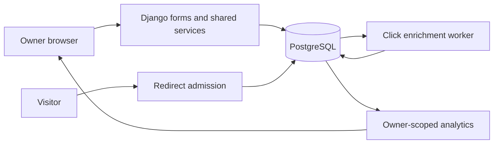

# Architecture and contracts

The browser uses Django templates and small same-origin JSON endpoints. PostgreSQL holds links, events, processing state, rate buckets, imports and audits. A second Python process runs `process_clicks --loop` against the same database. No separate SPA, Redis, Celery or microservices are required.

## Data model

| Entity | Relationship and purpose |
| --- | --- |
| Workspace | One owner; isolated links and organization. |
| Campaign / Folder / Tag | One workspace; unique name per workspace. |
| Link | Central record with globally unique alias, rules, optional campaign/folder and many tags. |
| ClickEvent | Belongs to link; outcome, source, metadata, pseudonymous browser key, enrichment/retry state. |
| BlockedDomain | Global administrator policy; exact hostname and subdomains. |
| AuditLog | Actor, link, action and timestamp; no plaintext passwords. |
| RateLimitBucket | Unique key + fixed minute window; atomic count. |
| ImportBatch | Workspace-owned UUID, preview rows/results and completion time. |
| PlatformSettings | Singleton operational policy, editable by authorized administrators. |
| BioPage | One per workspace; globally unique public slug; selected links. |

Aliases use 4–32 case-sensitive ASCII letters, digits, hyphens or underscores. Generated aliases use seven cryptographically random alphanumeric characters. Reserved management names are checked without regard to case. Database uniqueness arbitrates collisions; generated aliases retry. Published aliases remain fixed. Campaigns remain fixed after visits exist to preserve attribution. Owners pause links instead of deleting history.

## Redirect transaction

1. Capture bounded user-agent, referrer hostname, source hint and signed browser cookie.
2. Optionally derive country from the client IP using a local database; discard the IP.
3. Begin a transaction and lock the link using `SELECT FOR UPDATE`.
4. Check status → expiry → click allowance → destination safety → password grant.
5. Select mobile/tablet or desktop/default destination using the request user-agent.
6. For allowed requests, conditionally increment the lifetime redirect count.
7. Save one raw event for this known-link GET attempt, allowed or refused.
8. Commit, then issue HTTP 302, a password gate or an unavailable page.

If persistence fails, both counter and event roll back. PostgreSQL serializes admissions and rule edits on the same link. The concurrency test launches eight requests for one remaining click and requires exactly one success. A response lost after commit can still count; issuing a redirect cannot prove delivery to the destination.

HEAD never records an event or consumes a click. Unknown aliases return 404. Password challenges are recorded as GET attempts; unlock POSTs are rate-limited and do not count as redirects. Preview, QR download and owner details never create events. Redirect responses are private/no-store; successful redirects also suppress referrer disclosure.

## Password grants and safety

Django hashes passwords. Verification stores a server-session grant for the link's `rules_version` for 15 minutes. Edits and moderation increment that version. The next redirect rechecks every rule inside the transaction, so an old grant cannot bypass expiry, exhausted caps or takedowns. Per-link/per-client unlock limits use shared database buckets.

Destination validation is shared by forms/imports and redirect admission. It checks public HTTP(S) structure and the current domain blocklist. It never fetches the destination or asserts a malware verdict. Management views scope resources before access; relation choices and the creation service check workspace ownership again. QR, exports, import batches and JSON reporting follow the same rule. All mutations require POST and CSRF.

Administrators can create and edit business records across workspaces using permission-checked, workspace-validated forms. Link edits use the same transactional service as owner creation and invalidate grants; published aliases, counters and visited campaign attribution remain protected. Raw click events, import execution records and audits are read-only. Explicit moderation locks links and appends an audit. Editable platform settings control registration, rate limits and retention; environment secrets are not exposed.

Campaigns, folders and tags support rename, archive/restore and deletion when unused. Used groups cannot be deleted, preserving historical relationships. Archived groups remain on existing links and in reports but are unavailable for new assignments. Each group has period and lifetime totals and top links. Tag reports support combined campaign/tag filters; multi-tag counts intentionally overlap.

## Processing and analytics

Raw events form the durable queue. Workers claim rows with PostgreSQL `SKIP LOCKED`, enrich each row in place, mark completion and clear raw user-agent text. They never create a second event or increment a link count. Failures use exponential delays and stop after five attempts; `retry_clicks` requeues them after repair.

| Metric | Interpretation |
| --- | --- |
| Lifetime redirects | All allowed admissions, retained after event cleanup. |
| Period redirects | Allowed event records within selected UTC calendar days. |
| Likely humans | Allowed events classified as not bots; pending events excluded. |
| Estimated unique browsers | Distinct nonempty pseudonymous keys on likely-human allowed events. |
| Identification coverage | Share of likely-human events carrying a valid returning-browser key. |
| Blocked/challenged | Known-link GET outcomes other than allowed, including password challenges. |
| Country | Local GeoIP estimate or unknown; no raw address persistence. |

The signed, HTTP-only visitor cookie lasts 30 days. The event key is an HMAC, not the raw cookie. First visits have no established identifier and are left unidentified. Multiple browsers/cleared cookies affect estimates. These are not person counts. All report queries start with the current workspace; foreign campaign/link filters return no data. Staff platform reporting is a separate view.

## CSV contract

Preview accepts up to 200 UTF-8 rows and 256 KB with documented headers only. It uses the same form validation as manual creation, flags aliases repeated within the file and resolves existing campaign/tag names only in the current workspace. Preview saves no links.

Confirmation locks the batch, revalidates ready rows and calls the shared creation service. Stale aliases, new blocklist entries and rate limits become row errors. Invalid preview rows are skipped. Results and completion commit together; repeated confirmation returns the saved result. Preview expires after 30 minutes. Passwords are excluded from CSV.

## References

- [Django transactions](https://docs.djangoproject.com/en/5.2/topics/db/transactions/)
- [Django row locking](https://docs.djangoproject.com/en/5.2/ref/models/querysets/#select-for-update)
- [Django deployment checklist](https://docs.djangoproject.com/en/5.2/howto/deployment/checklist/)
